# 00 · 环境配置与基础概念：一个「没有 GPU」的 RL 训练栈是怎么成立的

> **课程资料**：[Agentic RL Lab](https://datawhalechina.github.io/agentic-rl-lab/)（Datawhale 开源教程，Apache-2.0）·
> 本章原文：[Getting Started](https://datawhalechina.github.io/agentic-rl-lab/experiments/getting-started/) ·
> 源码：`experiments/getting-started/readme.md`
>
> **我的笔记**：源码 [biociao/agentic-rl-lab · study 分支](https://github.com/biociao/agentic-rl-lab/blob/study/study/notes/00-getting-started.md) ·
> 在线阅读 [biociao.github.io](https://biociao.github.io/agentic-rl-lab/notes/00-getting-started) ·
> 博客镜像 [biochao.cc](https://biochao.cc/agentic-rl/00-getting-started/)
>
> **写作范围**：调研本章用到的平台、理清概念之间的关系、标出这套方法的边界；操作步骤不重复（见原文）。
> 更新：2026-11-16 · 对应 Datawhale 组队学习 Task00 · 引用与版权说明见文末 §7。

本节是课程的准备环节，为了便于上手实践，它采用了一种**训练范式的迁移**，即：

> 把「训练一个 LLM」从「我需要显卡并部署一套训练框架」变成「我只需要写一个 Python 脚本，剩下的交给远程服务器」

这个范式有时也叫做 **Train API**：训练服务把前向、反向、优化器更新、采样、权重保存暴露成 SDK 调用，
用户只需保留「数据、奖励、损失函数、循环」这四样东西。这一章的三件工具就是围绕这个范式配的：

| 需求 | 工具 | 具体作用 |
| --- | --- | --- |
| 算力 | PyTRIO | 远程训练引擎（前向/反向/采样/权重） |
| 观测 | SwanLab | 实验记录与对比 |
| 鲁棒 | uv + `uv.lock` | 环境版本固化 |

理解了这层动机，后面所有「为什么本地是 CPU 版 torch」「为什么每步要先存权重」就更好理解了。

## 1. 平台调研

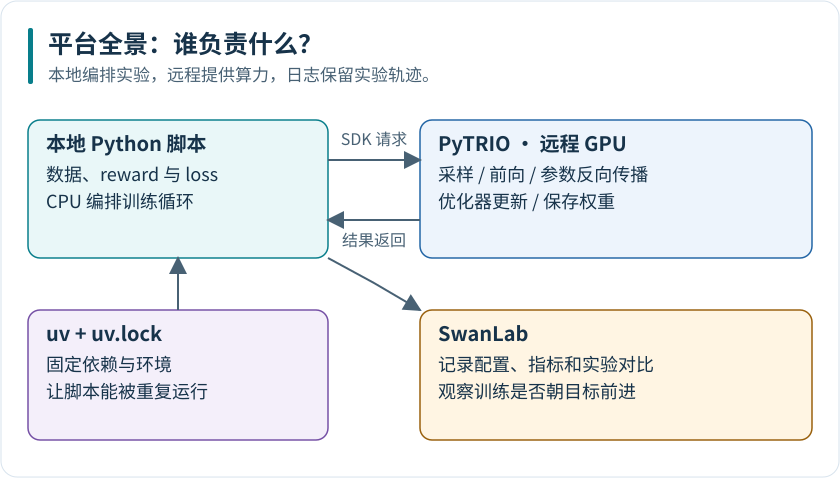

*图 1 · 三个平台各自补齐算力、环境和观测的一环；箭头表示调用、依赖或记录关系。*

### 1.1 PyTRIO：把「训练」做成 API

PyTRIO的官方定位很直白：**面向大语言模型后训练的全托管训练引擎**，支持 LoRA、SFT、RL、断点续训和权重下载；
用户脚本可以跑在**只有 CPU 的机器**上，服务端负责把计算扩展到 GPU 集群，换模型只需要改一个字符串
（[docs.pytrio.com](https://docs.pytrio.com/)）。

它的架构抽象出来只有四个，读懂这四个基本就读懂了全部章节的核心骨架：

| 概念 | 作用 | 类比 |
| --- | --- | --- |
| `Datum` | 组成一条训练样本：`model_input`（喂给模型的 token）+ `loss_fn_inputs`（喂给 loss 的参数：`target_tokens`、`logprobs`、`advantages`、`weights`） | 一条 batch 元素 |
| `forward_backward` | 前向 + 反向，返回 loss 与 metrics；`loss_fn=` 传内置损失名或自定义函数 | 一次梯度计算 |
| `optim_step` | 应用优化器更新 | 一步 SGD/Adam |
| sampler / `save_weights_for_sampler` | 用**当前**权重做推理采样；产物是 `trio://` 句柄 | 一份可推理的快照 |

**loss 执行路径有两条**：

- **内置 loss**：`cross_entropy`、`importance_sampling`、`ppo`、`cispo`、`dro` 五种，计算完全在服务端
  （[内置损失函数](https://docs.pytrio.com/docs/guide/loss_fn)）。本地 torch 并不参与。
- **自定义 loss**：`forward_backward_custom(datums, loss_fn)`。官方文档写到：
  
  > **「自定义损失函数始终在本地 Python 进程中执行。PyTRIO 从服务端取得当前模型的逐 Token logprob，
  > 在本地调用用户定义的函数，再把损失对 logprob 的梯度交给服务端完成模型参数的反向传播。」**
  > （[自定义损失函数](https://docs.pytrio.com/docs/guide/custom_loss)）

所以本地那份 torch 只用来算一个很小的计算图：`logprob 向量 → 标量 loss`，
梯度是 ∂L/∂logprob，真正的「对权重求导」发生在云端。这也解释了两件事：
为什么本地装 **CPU 版 torch** 就够（图很小，不需要显卡）；以及为什么「只用内置 loss 可以不装 torch」
（常见loss函数服务端上都有）。

但是PyTRIO**为什么只支持 LoRA？** 官方给的理由是：对许多重要场景（尤其 RL），LoRA 可以达到与全量微调相同的效果。
但我想实际的理由肯定还包括了LoRA所需的权重计算非常小。只有适配器体积小，`save_weights_for_sampler` 才能每步都做，
「每步换权重再采样」的 on-policy 循环才付担得起。

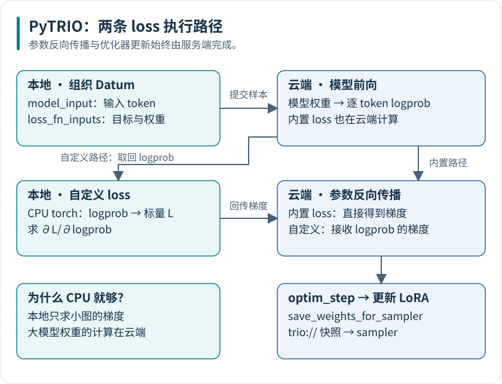

*图 2 · 重点区分「对 logprob 求导」和「对模型参数求导」：前者可以在本地 CPU 执行，后者仍在云端。*

### 1.2 SwanLab：RL 比 SFT 更需要实验记录

SwanLab 是国产的 AI 训练分析平台，功能是训练可视化、自动日志、超参数记录、实验对比和多人协同
（[文档](https://docs.swanlab.cn/guide_cloud/general/what-is-swanlab.html)）。

而对于RL训练而言，对训练记录工具的依赖程度可能还要远高于 SFT （我目前的工作都是SFT）。因为SFT 的健康信号是单一的：loss 单调下降，曲线不对劲基本就是数据或学习率问题。而RL 的信号并非「单调」，需要同时看 reward 均值、回答长度、`degenerate_fraction`、clip fraction、entropy。并且reward 上升也可能是 reward hacking 或长度爆炸这类“陷阱”。因此需要综合多种指标来监控训练是否朝着「有用」的方向在进行。

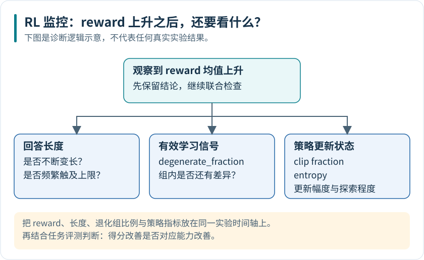

*图 3 · 这是监控的诊断顺序示意，不是真实训练曲线；单个指标改善不能单独证明训练有效。*

### 1.3 uv：环境本身就是实验的一部分

`uv sync` 严格按 `uv.lock` 建环境，Python 版本不足 3.13 时会自动补齐。哪怕换一个小版本，loss 的默认行为或日志字段就可能改变。把锁版本当实验记录的一部分，是训练任务中一个容易被忽略的好习惯。

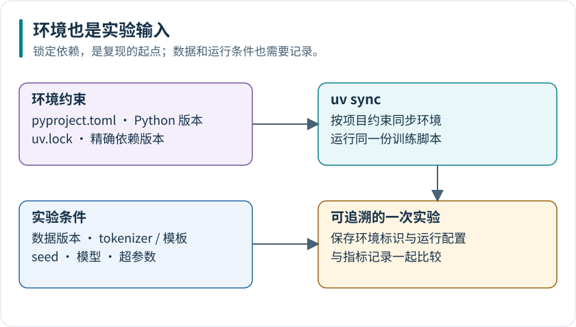

*图 4 · 环境锁定与实验条件记录需要一起做：`uv.lock` 本身不能固定数据、远程模型或随机过程。*

## 2. 概念调研

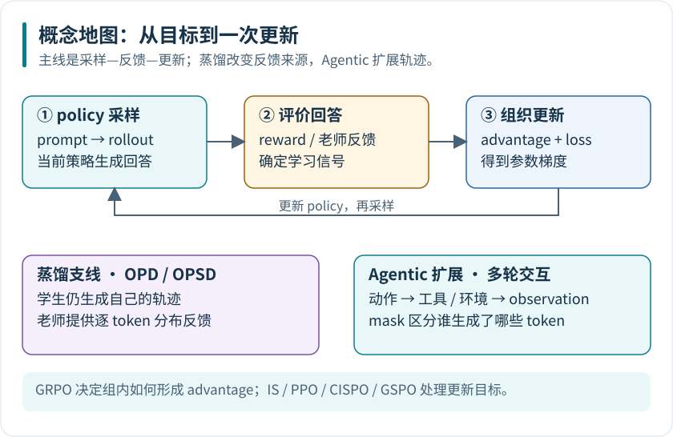

*图 5 · 先沿主循环定位概念，再看两条扩展：蒸馏改变反馈来源，Agentic 增加工具交互与掩码。*

### 2.1 三层范式：预训练、SFT、RL 的信号类型不同

| 范式 | 监督信号 | 一句话 |
| --- | --- | --- |
| PT/预训练 | 下一个 token | 学语言与世界知识 |
| SFT/监督微调 | 标准答案（逐 token 交叉熵） | 学「照着写」 |
| RL/强化学习 | reward（一条轨迹一个分） | 学「结果好坏」 |

关键差异不在数据量，而在**信号的粒度**：SFT 是每 token 都有一份监督（稠密），
RL 是整条回答只有一个分数（稀疏）。稀疏信号带来两个直接后果：
需要**自己采样**（没有现成答案可学）、需要**credit assignment**（整条回答的分数怎么分给每个 token）。
后面所有算法（GRPO、DAPO、GSPO、OPD……）都可以理解为对这两个问题的不同回答。

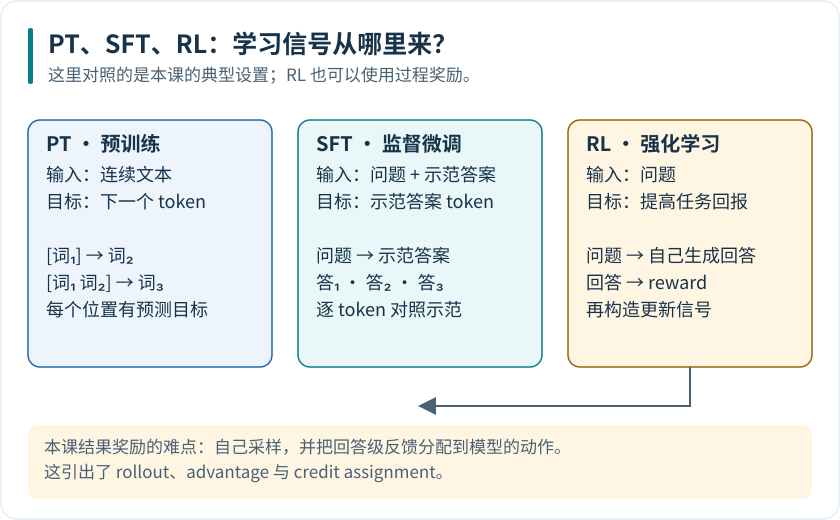

*图 6 · 对比本课采用的典型监督设置。回答级奖励是本课的设置，不代表所有 RL 都只有终局奖励。*

### 2.2 policy / rollout / on-policy：为什么训练循环长这样

- **policy**：当前在训的权重（这里是 LoRA 适配器）。
- **rollout**：从一个 prompt 出发生成的一条回答/轨迹。
- **on-policy**：训练数据由**当前** policy 采样。

把采样分布记为 `p_old`、要优化的目标分布记为 `p_new`。当两者不一致时，就需要用重要性采样去纠正（要求采样分布覆盖目标分布的支持集）：

```text
E_{p_new}[f(x)] = E_{p_old}[ (p_new(x)/p_old(x)) · f(x) ]
ratio = p_new / p_old
```

这个 `ratio` 就是后面所有 loss 的核心变量。而「`p_old` 要多接近 `p_new`」会影响这个估计的方差：
差得越远，比率越极端，梯度噪声越大。

所以 demo 每个 step 都要「先保存当前权重 → 拿到 sampler → 采样」，这不是某种工程洁癖，
而是为了**让采样策略接近待优化策略的算法要求**。代价是每步都要做一次权重同步 + 一次网络往返。

> 补充一个容易忽略的点：若采样快照、推理设置与当前参数完全一致，首次更新前 `ratio` 可以等于 1。
> 参数更新或存在 policy lag 后，它可能偏离 1；因此更新目标需要考虑这种偏离。

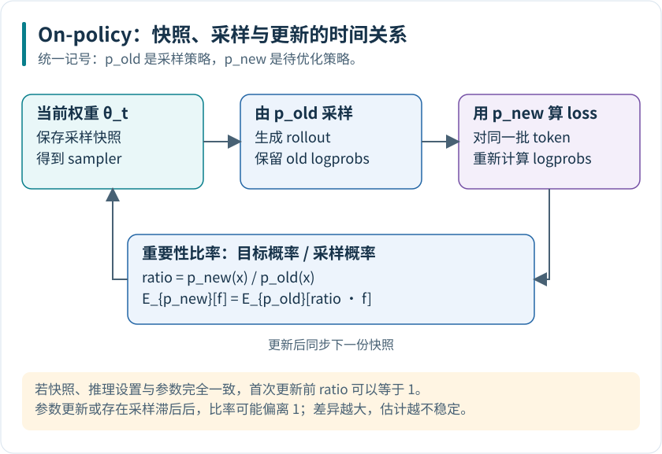

*图 7 · 统一用 `p_old` 表示采样分布、`p_new` 表示目标分布，因此比率是 `p_new / p_old`。完全一致的策略在首次更新前可以得到 `ratio = 1`。*

### 2.3 reward：把目标函数工程化

虽然教程说「reward 是给回答打的分」，但 reward 的设计空间很大，甚至决定了整个实验的上限。按信息来源分三类：

| 类型 | 例子 | 特点 |
| --- | --- | --- |
| 可验证答案 | GSM8K 的 `\boxed{}` 是否匹配 | 客观、便宜、但只适用于有唯一解的任务 |
| 过程/格式 | Search-R1 的格式分与搜索行为分 | 引导行为，但容易过拟合到「看起来对」 |
| 环境判定 | ALFWorld 任务是否完成 | 最接近真实 agent 目标，但稀疏且慢 |

它们的共同风险是 **reward hacking**，也就是模型只学会了拿分而不是学会做事（比如输出格式对但推理错、
或者无限拉长回答骗 partial credit）。很像是为了完成KPI而进行的无效加班……

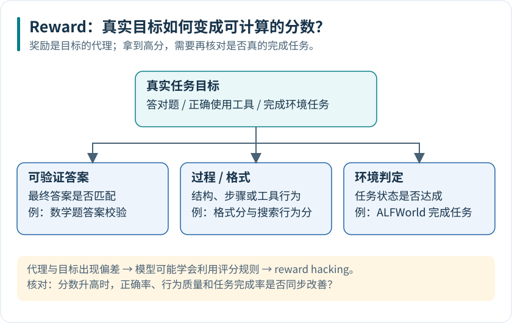

*图 8 · 三类奖励是不同的目标代理。评分规则被满足后，还需要核对真实任务是否完成。*

### 2.4 GRPO：去掉 critic 的收益与代价

GRPO (Group Relative Policy Optimization) 出自 DeepSeekMath（[arXiv:2402.03300](https://arxiv.org/abs/2402.03300)），后来被我们梁圣的**DeepSeek-R1**
（[arXiv:2501.12948](https://arxiv.org/abs/2501.12948)）发扬光大。它解决的具体问题是：
PPO（proximal policy optimization, [arXiv:1707.06347](https://arxiv.org/abs/1707.06347)）需要一个和 policy 同量级的 **critic（价值网络）**来估计 baseline，而显存和工程复杂度都会翻倍。

GRPO 的做法是**用组内相对值代替 baseline**：同一道题采 K 条回答，用组内均值当基线：

```text
A_i = (r_i − mean(r_1..K)) / std(r_1..K)      # 原版
A_i =  r_i − mean(r_1..K)                    # 本仓库 demo 的简化版
```

好处：省掉 critic，内存和实现都大幅简化。代价则是**degenerate group**：当K 条回答全对或全错时，组内方差为 0，advantage 全 0，这一组将没有任何学习信号。这是 GRPO 的**结构性成本**：它把「基线估计」的负担从模型转移到了**数据难度**上，所以题目必须落在模型能力的「最近发展区」里。

> 数据侧的应对后来被 DAPO 系统化了（使用了**Dynamic Sampling**，通过将过滤掉全对/全错的组再补齐 batch），
> 见 2.5。

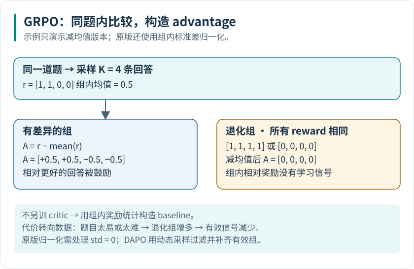

*图 9 · 演示数值：`[1, 1, 0, 0]` 减去均值 `0.5` 后得到正负 advantage；所有奖励相同则相对信号为零。*

### 2.5 Loss 谱系：从 IS 到 PPO、CISPO、GSPO

本课作为入门只用一段话带过，但它是整本教程的主干。我按「核心改动」排一张表：

| 方法 | 来源 | 核心改动 | 解决的问题 | 代价 |
| --- | --- | --- | --- | --- |
| Importance Sampling | 经典算法 | `ratio · A` | 用旧数据估计新策略 | 比率无上界，方差爆炸 |
| PPO | [1707.06347](https://arxiv.org/abs/1707.06347) | `min(ratio·A, clip(ratio)·A)` | 限制单步更新幅度 | 被 clip 的 token 梯度归零，探索受限 |
| DAPO | [2503.14476](https://arxiv.org/abs/2503.14476) | Clip-Higher、动态采样、token 级 loss、超长 shaping | 熵坍缩、无效样本、长序列主导、截断噪声 | 超参更多 |
| CISPO | [2506.13585](https://arxiv.org/abs/2506.13585)（MiniMax-M1） | `detach(clip(ratio)) · logprob · A` | 上界仍然有效，但不把 token 的梯度剪没 | 需要重新理解「谁在走梯度」 |
| GSPO | [2507.18071](https://arxiv.org/abs/2507.18071)（Qwen） | 序列级 ratio + 序列级 clip | token 级重要性权重在统计上是「不适定」的用法 | 粒度变粗，长序列内差异被平均 |

几个值得记住的**因果链**：

- PPO 的 `min` 是「保守更新」：一旦某个 token 的 ratio 冲太远，就不再加权。副作用是这个 token彻底不再贡献梯度——CISPO 正是针对这点，把 clip 后的 ratio **detach 成常数**，让梯度继续从`logprob` 流过，只是力度被设定了上限。
- GSPO 的做法更激进：把序列里每个 token 各自乘一个重要性比率，得到的不是序列级目标的正确估计（长度越长偏差越大）。它改用**长度归一化的序列似然比**，整条序列共享一个比率和一个裁剪区间。Qwen3 的 RL 训练用的是这条路线。
- DAPO 的四项技术可以逐条对应到 GRPO 的四个痛点：熵坍缩 → Clip-Higher；无效组 → Dynamic Sampling；
  长序列主导 → token 级 loss；截断噪声 → Overlong Reward Shaping。

> 01 章将介绍同一个骨架的四种变形，后面 DAPO/GSPO 会把这类变形推到更极致的位置。

顺便记一个理论进展：有研究表明 GRPO 的策略梯度可以写成 **U-statistic** 的形式，并指出它优化的
其实是期望奖励的 ℓ₂ 变换而非期望奖励本身（[arXiv:2603.01162](https://arxiv.org/abs/2603.01162)）。这类结论不影响咱跑实验，但可以提醒我们：**「GRPO 是 PPO 的简化」是一种工程化叙事，并不等价于已证实的理论**。

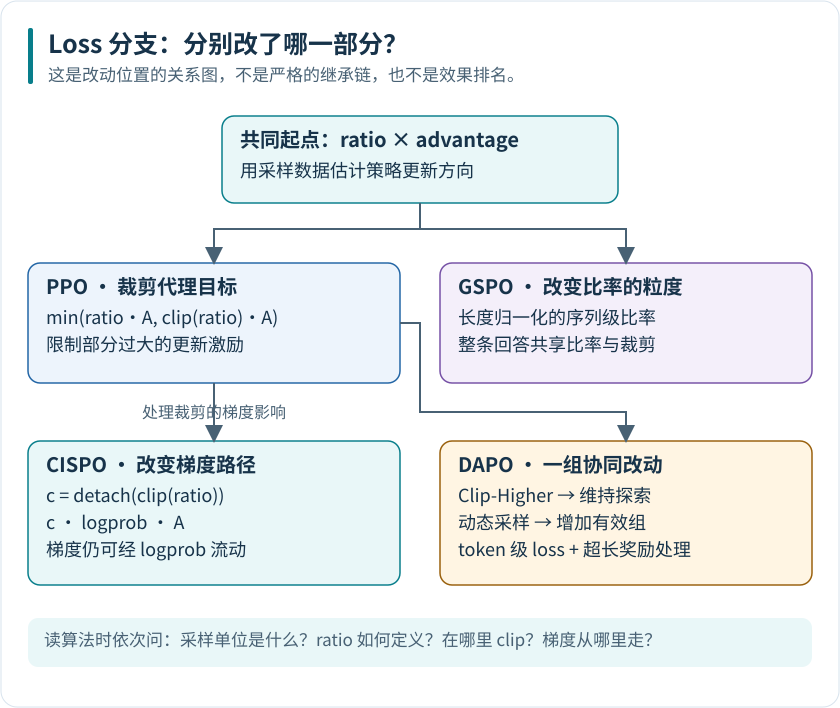

*图 10 · 按「改动发生在哪里」阅读，而不是把这些方法理解为严格的线性升级。图中省略目标的求和、取负及其他正则项。*

### 2.6 蒸馏支线：OPD 与 OPSD

本课只用两行一笔带过，但它其实是一条完整的技术线：

- 传统蒸馏：学生在**固定数据或老师预生成的答案**上学，训练分布和推理分布存在偏移。
- **GKD**（[arXiv:2306.13649](https://arxiv.org/abs/2306.13649)）提出让学生在**自己生成的序列**上接受老师反馈；**MiniLLM**（[arXiv:2306.08543](https://arxiv.org/abs/2306.08543)）则论证生成模型更适合 **reverse KL**。
- 而 **OPD** 基本就是这两者的结合：轨迹由学生生成，老师只对这些轨迹打逐 token 分数，用 reverse KL 当 advantage。

为什么是 reverse KL 而不是 forward KL？直觉是forward KL 要求学生覆盖老师的所有模式（mode-covering），会把学生拉向「平均答案」，而reverse KL 是 mode-seeking，学生倾向于**锁定老师的某个高概率模式**。对生成长文本的人物来说，后者更符合「学会一种解法」而不是「学会所有解法的平均」。

**OPSD**（[arXiv:2601.18734](https://arxiv.org/abs/2601.18734)）则再往前走了一步：teacher 就是**step 0 的自己**，只是 prompt 里多给了参考答案。于是「老师」不需要更强的模型，成本几乎为零，本质上是**用参考答案给自己判卷**，同时缓解训练过程中的能力遗忘。

> 在这套范式里，OPD 的实现成本极低：PyTRIO 提供 `compute_logprobs()`，直接使用
> 「prompt + 学生生成的 completion」返回逐个 token logprob，而**不需要让 teacher 重新生成**。
> 这是「远程推理 API」相比自建服务的一个实际优势——见 09 章。

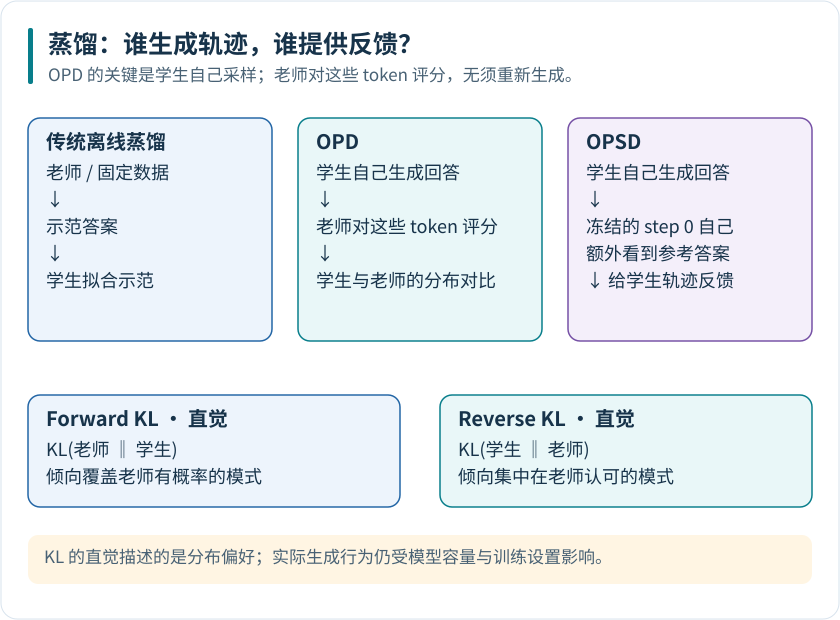

*图 11 · 先分清「谁生成轨迹」与「谁给反馈」，再看 KL 方向。OPSD 的老师条件还包含参考答案，不能等同于学生当前的生成条件。*

### 2.7 Agentic 层：多轮与 observation mask

前面所有讨论都假设「一条回答 = 一个动作序列」。Agentic RL 则把这条链路拉长：
模型可以在中途调工具（搜索、代码解释器、TextWorld 环境），工具返回的内容成为新的上下文。

这带来两个新问题：

1. **信用分配变难**：一条轨迹可能有几十轮，最终 reward 只有一个。哪一轮该负责？
2. **谁说的话要进 loss**：observation 是**环境**产生的，不是模型的动作。强化它等于教模型
   「学会说出环境会说的话」，是纯粹的噪声。

工程上的解法就是 **observation mask**：把 observation 区间的 `logprobs` 和 `advantages` 置 0。
在 PyTRIO 的 `Datum` 里，这件事有一个统一入口——`loss_fn_inputs` 的 `weights`（0/1 掩码）。
于是有三种「不该学的 token」通过同一个机制进行了覆盖：

| 场景 | 屏蔽对象 | 位置 |
| --- | --- | --- |
| SFT | padding / prompt | `weights` |
| RL | prompt 前缀 | `advantages = 0` |
| Agentic RL | 工具返回的 observation | `advantages = 0` |

> 这个统一视角比暴力「填 0」更有用：**训练的本质是选择哪些 token 对梯度有贡献**，而 mask 是表达这个选择的通用语言。

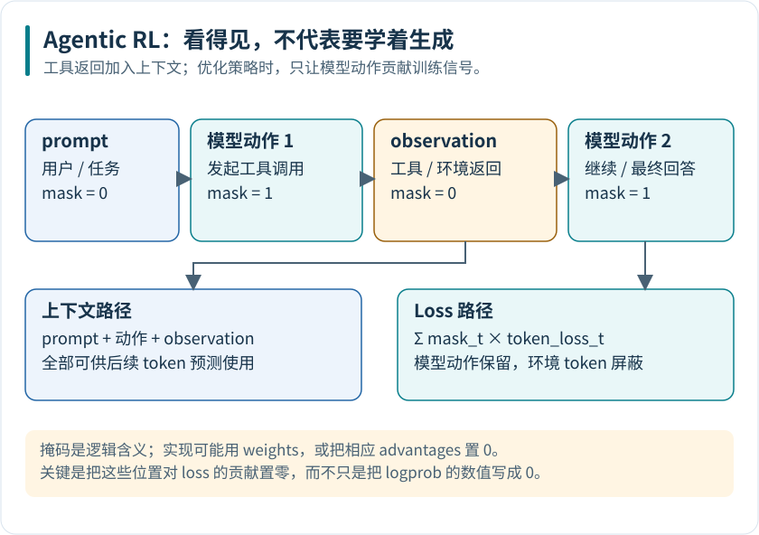

*图 12 · `mask = 0/1` 表示逻辑上的训练贡献。工具返回仍可被模型读取；实现时需确保其 loss 贡献为零，具体字段随 loss 接口而定。*

## 3. 将训练循环视作一个系统

把这一课所采用的部署模式连起来，会发现训练中的一次 step 包含了六个动作，其中三个在本地、三个在云端：

```text
本地  ① 取 batch、拼 prompt（tokenizer + chat template）
云端  ② 用当前权重采样 K 条回答 → 返回 tokens 与 logprobs
本地  ③ 算 reward → 组内减均值得 advantage → 打包 Datum
云端  ④ forward/backward（内置loss）或本地算自定义loss再回传梯度
云端  ⑤ optim_step 更新LoRA
本地  ⑥ 记录指标、进入下一步
```

三个「隐藏成本」决定了这套架构的实验规模：

- **往返延迟**：每步至少两次网络交互 → 这应该是采用异步 API（`*_async` + `await`）的原因；
- **采样成本**：K 条 × 最大长度，rollout 反而是成本大头，不是梯度；
- **可复现性**：数据版本、tokenizer、chat template、seed 任一漂移，曲线就不连贯了（就不可比了）。

所以「demo 只跑十几步」不是偷懒，而是**把预算花在算法对照上**：同一批 prompt、同一个模型，
只改一个变量（loss 名、`group_size`、clip 区间），观察到曲线的变化趋势即可。

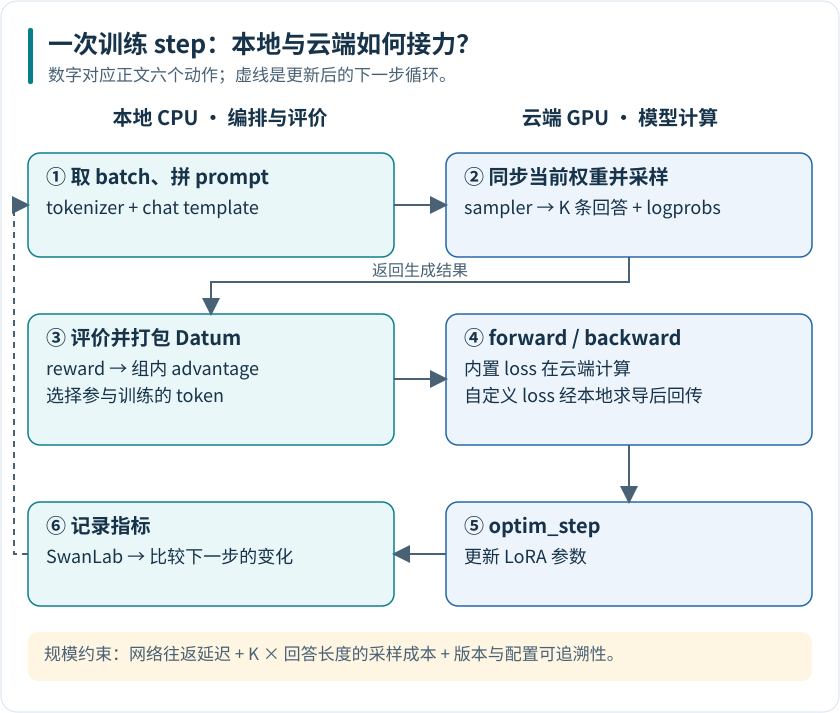

*图 13 · 两列是执行位置，实线是本步依赖，虚线进入下一步；自定义 loss 在第 ④ 步额外经过本地计算图。*

## 4. 这一节课的Scope（个人判断）

- **「不需要 GPU」不等于「没有成本」**。成本只是从「买卡」转移到了「按量计费的采样与训练」，而且多了网络往返这一层新的不确定性。虽然教学 demo 的价格可以忽略，并且对于教学来说这种方式更易于上手。但在做实际任务时不能忽略。
- **LoRA-only 是有意的取舍**。它让「每步换权重」可行，但也意味着这里的所有结论都建立在「适配器足够表达任务变化」的假设上。想研究全参微调的动态（比如更大规模下的熵行为）的话，还得评估合适的技术栈。
- **跨平台暂不可比**。官方明确说没有验证过的 Tinker 移植、没有性能对比，所以不能拿这里的
  step 数 / 效果去和 Tinker 上的结果对齐。

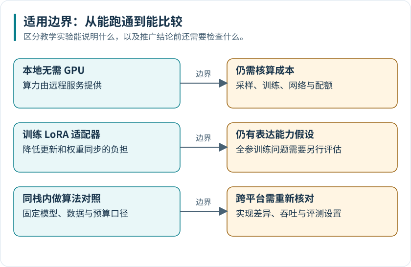

*图 14 · 每项便利都对应一个适用条件。把这些条件写进实验结论，才能判断结果能否推广。*

## 5. 索引：这一章牵出的论文与文档

| 概念 | 参考文献 |
| --- | --- |
| PyTRIO 训练范式 / 自定义 loss | [docs.pytrio.com](https://docs.pytrio.com/) · [custom_loss](https://docs.pytrio.com/docs/guide/custom_loss) · [loss_fn](https://docs.pytrio.com/docs/guide/loss_fn) |
| Tinker（同范式先行者） | [tinker-docs.thinkingmachines.ai](https://tinker-docs.thinkingmachines.ai/) · 本仓 [Tinker 与 PyTRIO 对照](https://datawhalechina.github.io/agentic-rl-lab/guide/tinker-pytrio.html) |
| SwanLab | [docs.swanlab.cn](https://docs.swanlab.cn/guide_cloud/general/what-is-swanlab.html) |
| GRPO | [arXiv:2402.03300](https://arxiv.org/abs/2402.03300)（DeepSeekMath）· [2501.12948](https://arxiv.org/abs/2501.12948)（R1） |
| PPO | [arXiv:1707.06347](https://arxiv.org/abs/1707.06347) |
| DAPO | [arXiv:2503.14476](https://arxiv.org/abs/2503.14476) |
| CISPO | [arXiv:2506.13585](https://arxiv.org/abs/2506.13585)（MiniMax-M1） |
| GSPO | [arXiv:2507.18071](https://arxiv.org/abs/2507.18071)（Qwen） |
| LoRA | [arXiv:2106.09685](https://arxiv.org/abs/2106.09685) |
| OPD 谱系 | [GKD 2306.13649](https://arxiv.org/abs/2306.13649) · [MiniLLM 2306.08543](https://arxiv.org/abs/2306.08543) |
| OPSD | [arXiv:2601.18734](https://arxiv.org/abs/2601.18734) |

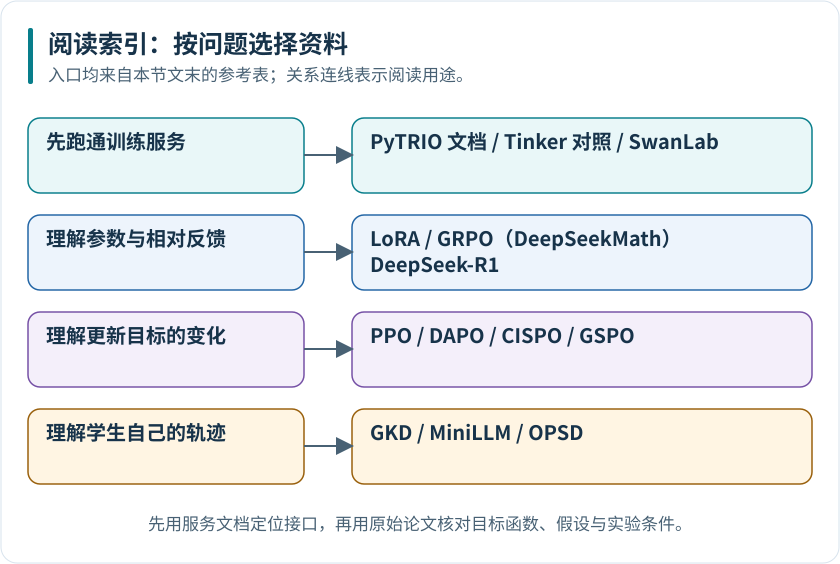

*图 15 · 阅读导航，具体链接见上表；连线仅表示资料用途，不代表论文之间的严格继承关系。*

## 6. 待探索问题

- [ ] PyTRIO 的计费口径是什么（按 token？按 GPU-秒？）？做一组 5 组超参的对照实验大概多少钱？
- [ ] 自定义 loss 只回传 ∂L/∂logprob，那**二阶信息**（比如需要 Hessian 的方法）在这套栈里能做吗？
- [ ] demo 的 advantage 省掉了除以 std。在 K=4 这么小的组里，除 std 会不会反而放大噪声？（已知 std=0 会退化，这也是原版要加 eps 的原因）
- [ ] 内置 `cispo` 已有，仓库仍手写一份 custom 版本——是教学演示目的？
- [ ] GSPO 的「序列级比率」在多轮 Agentic 场景下怎么定义？一个 episode 里含多次工具调用时，序列边界是「一条 completion」还是「整个 episode」？

## 7. 引用与版权说明

本节对应 Datawhale 组队学习的要求：**笔记中引用教程内容或其他资料，需注明出处并附来源链接**。
以下按「课程资料 / 我的笔记 / 其它参考资料 / 配图」四类分别标注。

### 7.1 课程资料（引用主体）

| 项目 | 内容 |
| --- | --- |
| 教程名称 | Agentic RL Lab（首个成体系的 Agentic RL 中文开源教程） |
| 出品 / 维护 | Datawhale；作者 KMnO4-zx（宋志学）及 Datawhale 团队 |
| 在线阅读 | <https://datawhalechina.github.io/agentic-rl-lab/> |
| 源码仓库 | <https://github.com/datawhalechina/agentic-rl-lab> |
| 本章原文 | <https://datawhalechina.github.io/agentic-rl-lab/experiments/getting-started/>（`experiments/getting-started/readme.md`） |
| 许可证 | Apache License 2.0（见仓库 [LICENSE](https://github.com/datawhalechina/agentic-rl-lab/blob/main/LICENSE)） |

引用方式说明：本笔记对课程内容以**转述、概括与对照**为主，未整段复制原文；原文的操作步骤（安装、登录、
命令清单）没有重复收录，需要按步骤操作时请回到原文。若本笔记与原文表述冲突，**以原文为准**。

### 7.2 本笔记

| 项目 | 内容 |
| --- | --- |
| 源码 | <https://github.com/biociao/agentic-rl-lab/blob/study/study/notes/00-getting-started.md> |
| 仓库目录 | <https://github.com/biociao/agentic-rl-lab/tree/study/study/notes> |
| 在线阅读 | <https://biociao.github.io/agentic-rl-lab/notes/00-getting-started> |
| 博客镜像 | <https://biochao.cc/agentic-rl/00-getting-started/> |
| 许可证 | [CC BY-NC-SA 4.0](https://creativecommons.org/licenses/by-nc-sa/4.0/deed.zh-hans)（署名—非商业性使用—相同方式共享） |

引用本笔记时，请保留作者署名与上述链接；转载或改编需遵守 CC BY-NC-SA 4.0。

### 7.3 其它参考资料

本文涉及的第三方资料包括 PyTRIO 官方文档、Tinker 官方文档、SwanLab 文档，以及 GRPO、PPO、DAPO、
CISPO、GSPO、LoRA、GKD、MiniLLM、OPSD 等论文，**逐条链接见文末 §5「索引：这一章牵出的论文与文档」**，
此处不重复罗列。对这些资料的引用同样是概述与对照，公式、结论与实验条件请以原文与官方文档为准；
相关名称与成果版权归各原作者与机构所有。

### 7.4 配图

文中 15 张示意图均为本笔记原创，由 [`study/scripts/draw_getting_started.py`](https://github.com/biociao/agentic-rl-lab/blob/study/study/scripts/draw_getting_started.py)
生成（纯 SVG，未使用第三方素材或截图），随本笔记在 CC BY-NC-SA 4.0 下复用；图中出现的产品名与论文名
仅用于指代，不代表其官方立场。
