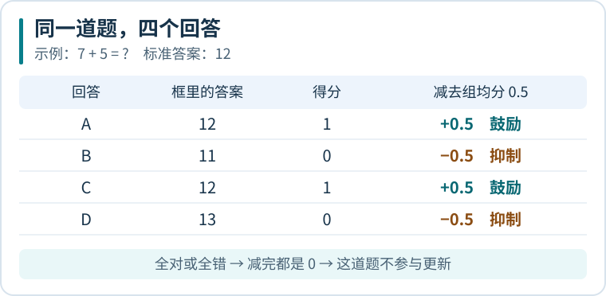
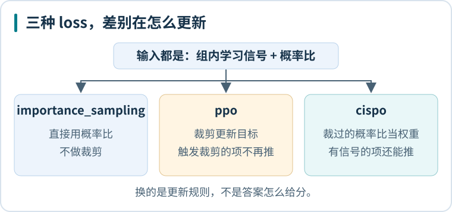
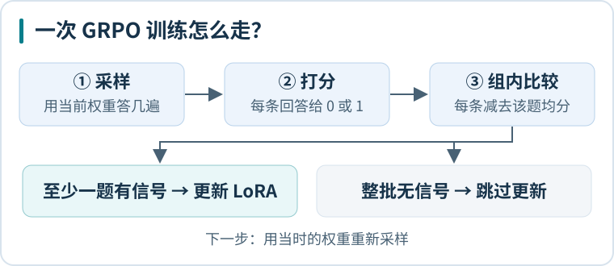
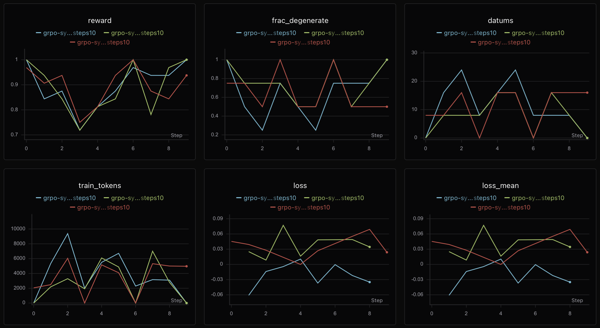

# 02 · GRPO 学习记录

> **Datawhale 组队学习 Task02** · 2026-11-18 ~ 11-20
> **课程资料**：[GRPO 原文](https://datawhalechina.github.io/agentic-rl-lab/experiments/grpo/) · [Loss Functions](https://datawhalechina.github.io/agentic-rl-lab/experiments/loss-functions/)
> **我的笔记**：[源码](https://github.com/biociao/agentic-rl-lab/blob/study/study/notes/02-grpo.md) · [在线阅读](https://biociao.github.io/agentic-rl-lab/notes/02-grpo) · [博客镜像](https://biochao.cc/agentic-rl/02-grpo/)

## 一、GRPO 想解决什么问题

**监督微调**：给模型标准答案，让它照着写。但问题在于，训练时它永远只见过"正确"的答案，
到了自己答题的时候，没法判断哪条路更有希望。

**强化学习**：让模型自己答，再给答案评分，答得好的方式以后多用，答得差的少用。
但问题是，一条回答中间的决策过程可能很长，如何有效地奖励正确或高效的逻辑链？

**PPO 的办法**：额外训练一个"估分模型"，让它估计"在这个位置，大概能拿多少分"，
再拿实际得分和估计值比较。实践中，这个估分模型通常和主模型一样大，显存和工程复杂度都要翻倍。

**GRPO 的办法**：不训估分模型了。同一道题让模型答好几遍，用这几遍的**平均分**当参照线。
比平均分高的回答被鼓励，比平均分低的被diss。

## 二、几个重要概念

### 概念一：衡量好坏的基准是「反复答题的平均分」

例如模型对一道题答了4遍，其中 3 遍答对。每遍的得分是 1 或 0。
把这 4个分数求平均，再从每个分数里减去这个平均值，得到的就是**优势**。

比如四遍回答的得分是 1、0、1、0：

```text
平均分 = 0.5
优势   = +0.5、−0.5、+0.5、−0.5
```

答对的那两遍被往上推，答错的那两遍被往下压。注意：**答错不是"不学"，而是"往反方向学"**。

这里会有一个反直觉的结论：如果四遍全对（1、1、1、1），平均分是 1，优势全是 0；
四遍全错也一样。**全对和全错在算法眼里是同一件事：没有相对差别，这一组白采。**



*图 1 · 示例*

**验证脚本**：`study/scripts/grpo/01_group_comparison.py`

```bash
uv run --offline --no-sync python study/scripts/grpo/01_group_comparison.py
```

它调用训练脚本里真实的打分和优势计算函数，喂进去的是固定回答。我跑出来的结果
（为了省篇幅，把原来分行的输出并成了一行）：

```text
情况一：四条回答里两条答对（标准答案是 12）
  每条回答的得分：[1.0, 0.0, 1.0, 0.0]    平均分：0.50    优势：[0.5, -0.5, 0.5, -0.5]

情况二：只有一条答对
  每条回答的得分：[1.0, 0.0, 0.0, 0.0]    平均分：0.25    优势：[0.75, -0.25, -0.25, -0.25]

情况三：四条都答对
  每条回答的得分：[1.0, 1.0, 1.0, 1.0]    平均分：1.00    优势：[0.0, 0.0, 0.0, 0.0]

情况四：四条都答错
  每条回答的得分：[0.0, 0.0, 0.0, 0.0]    平均分：0.00    优势：[0.0, 0.0, 0.0, 0.0]
```

同样是一分，含金量不一样。情况二里答对的那条领先 0.75，情况一里只领先 0.5。所以"答对"本身没有固定价值，价值取决于这一组有多难。

### 概念二：概率比，说明"现在比当时更喜欢它多少"

到这里有个新问题：训练时用的数据，是**之前**那版模型采样出来的。
现在的模型已经不是当时那个模型了，同样的token，它现在的偏好可能变了。

所以代码里要存两份对数概率：

- **采样时的那份**：回答生成时的历史记录，跟着这条回答一起保存；
- **现在的那份**：训练时重新算的当前偏好。

两者一除（代码里是相减再取指数）就是**概率比**。比值大于 1 表示现在更偏好，小于 1 反之。

**验证脚本**：`study/scripts/grpo/03_probability_ratio.py`

```bash
uv run --offline --no-sync python study/scripts/grpo/03_probability_ratio.py
```

关键的三组数字：

```text
采样时 0.10，现在 0.50 → 概率比 5.00   （现在更喜欢它）
采样时 0.50，现在 0.10 → 概率比 0.20   （现在更不喜欢它）
采样时 0.50，现在 0.50 → 概率比 1.00   （没有任何变化）
```

最后一行是关键：**如果把历史记录覆盖成当前值，概率比永远是 1，训练就等于没做。**
这也解释了为什么每一步都要先保存一份权重、再拿它去采样——那份权重就是"当时"的模型。

### 概念三：三种损失函数，差别于在怎么利用这个概率比

有了评价偏好，有了概率比，剩下的问题只有一个：怎么把它们变成一个梯度。
教程提供了三种损失函数。

**验证脚本**：`study/scripts/grpo/04_loss_differences.py`

```bash
uv run --offline --no-sync python study/scripts/grpo/04_loss_differences.py
```

```text
优势为正（+0.5）：
  importance_sampling：梯度 -2.50
  PPO：                梯度  0.00  ← 这一项被裁剪掉了，不再继续推
  CISPO：              梯度 -2.00

优势为负（−0.5）：
  importance_sampling：梯度 +2.50
  PPO：                梯度 +2.50
  CISPO：              梯度 +2.00
```

比值冲到上界时，PPO 直接把这一项的梯度变成 0。
而 CISPO 同样限制力度，但限制的是乘上去的权重，所以梯度是 −2.00，变小了但没消失。

PPO 只在"推过头"时叫停。优势为负、比值又很高的时候，它并不会停（上表第二组）。



*图 2 · 三种损失都从同样的字段出发：组内优势、采样时与训练时的概率。*

## 三、一次GRPO训练到底发生了什么



*图 3 · 下一步用当时的权重再采样，不是反复训练同一批旧回答。*

```text
① 取 4 道题
② 保存一份当前权重，用它把每道题各答 8 遍 
③ 每道题的 8 条回答打分，减去组内平均分
④ 每条回答的优势复制给它的每个token，题目填 0
⑤ 采用一种loss函数，把优势和概率比变成梯度，更新权重
```

这里有一个容易忽略的点：每次循环都换一批新题，而且模型每步都在变。
所以曲线上的抖动，既可能是模型变了，也可能只是这一步的题更难。

## 四、教程实战

### 第一步：数据下载

遇到报错是 `Couldn't find any data file at .../openai/gsm8k`，后面跟着 `LocalEntryNotFoundError`。
我第一反应是网络被墙，结果查下来发现：我以前配置的`hf-mirror.com` 现在会把下载请求跳回 huggingface.co，
而新版下载库认为"落地的地址和我配置的不一样"，判定失败。

```bash
HF_ENDPOINT=https://huggingface.co uv run python experiments/grpo/01-demo-sync.py ...
```

覆盖成官方地址就好，数据只有 2.3 MB，约 20 秒。

### 第二步：先跑一步，确认链路

```bash
uv run python experiments/grpo/01-demo-sync.py \
  --steps 1 --batch-size 2 --group-size 4 --max-tokens 512 \
  --loss-fn importance_sampling --swanlab-mode online
```

参数的含义：一道题答 4 遍（`--group-size 4`），一次做 2 道题（`--batch-size 2`），
每条回答最多 512 个token。

### 第三步：三组各跑十步

```bash
# 三组只差 --loss-fn
uv run python experiments/grpo/01-demo-sync.py \
  --steps 10 --batch-size 4 --group-size 8 --max-tokens 512 --seed 42 \
  --loss-fn importance_sampling --swanlab-mode online

uv run python experiments/grpo/01-demo-sync.py \
  --steps 10 --batch-size 4 --group-size 8 --max-tokens 512 --seed 42 \
  --loss-fn ppo --swanlab-mode online

uv run python experiments/grpo/01-demo-sync.py \
  --steps 10 --batch-size 4 --group-size 8 --max-tokens 512 --seed 42 \
  --loss-fn cispo --swanlab-mode online
```



*图 4 · 三组十步的对照。图例里三个实验名都被截断成 `grpo-sy...steps10`，颜色和损失的对应关系要回控制台才能确认。*

## 五、我的思考

如果有些问题模型总给出很强的错误答案的概率，每次采用总是得到错误答案，应该如何从GRPO中学习呢？通常的奖励函数将无法获得有效的学习偏好。

那是否能用答案的概率上找找差异？毕竟即使是相同的错误答案，每次采样给到的概率总有差异，我觉得可以取正确答案概率的中位数作为基线，高于它的加分（相应差值），低于的减分。

我一找还真有相关方法。**用 thinking 结束后正确类别的概率给每条轨迹打分，即使 多次采样的 argmax 全错，GRPO 也能得到组内偏好**。这几篇文献里，正确答案概率作为奖励、组内中位数作为优势基线，都有直接先例。

| 文献                                                         | 和你方案的关系                                               |
| ------------------------------------------------------------ | ------------------------------------------------------------ |
| **VeriFree，ICLR 2026**                                      | 采样推理轨迹后，直接计算给定轨迹时参考答案的概率，用它训练推理。论文的目标里还包含更新参考答案输出的梯度项。 [论文](https://openreview.net/pdf/0b1996ccf03e5793adb7388a6b8e25518ab6a14b.pdf) |
| **Likelihood-Based Reward Designs for General LLM Reasoning** | 直接比较参考答案的概率和对数概率等奖励。论文明确指出，奖励只依赖推理轨迹和参考答案，因此可以省去最后一步答案采样。 [论文 §2](https://arxiv.org/html/2602.03979v1#S2) |
| **MC-GRPO，2026 年预印本**                                   | 用同一 prompt 下各轨迹奖励的**中位数**替代均值，并用中位数绝对偏差归一化。它保留每条轨迹离中位数的距离。论文用 \(G+1\) 条采样，去掉优势为零的中位轨迹。 [论文 §3](https://arxiv.org/html/2601.22582v1#S3) |

果然我能想到的别人早就试过了，哈哈哈。

## 八、引用

| 内容 | 链接 |
| --- | --- |
| 教程 | [Agentic RL Lab](https://datawhalechina.github.io/agentic-rl-lab/)（Datawhale，Apache-2.0） |
| 本章原文 | [experiments/grpo](https://datawhalechina.github.io/agentic-rl-lab/experiments/grpo/) · 本地 `experiments/grpo/readme.md` |
| 前置阅读 | [Loss Functions](https://datawhalechina.github.io/agentic-rl-lab/experiments/loss-functions/) |
| 训练服务文档 | [PyTRIO 损失函数](https://docs.pytrio.com/docs/guide/loss_fn) · [自定义损失](https://docs.pytrio.com/docs/guide/custom_loss) |
| 记录工具 | [SwanLab 文档](https://docs.swanlab.cn/) |
| 论文 | [DeepSeekMath（GRPO 出处）](https://arxiv.org/abs/2402.03300) · [PPO](https://arxiv.org/abs/1707.06347) · [CISPO](https://arxiv.org/abs/2506.13585) · [Dr. GRPO](https://arxiv.org/abs/2503.20783) |
| 原始日志 | `study/notes/assets/02-grpo/runs-2026-11-20/`（三组十步，含权重路径） |

本笔记与示意图采用 [CC BY-NC-SA 4.0](https://creativecommons.org/licenses/by-nc-sa/4.0/deed.zh-hans)。
