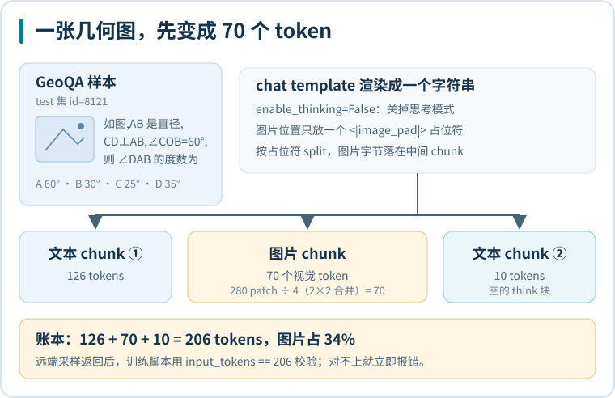
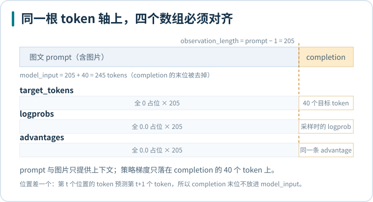
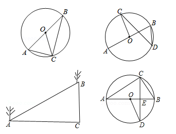
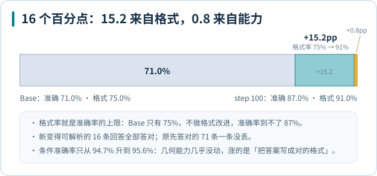
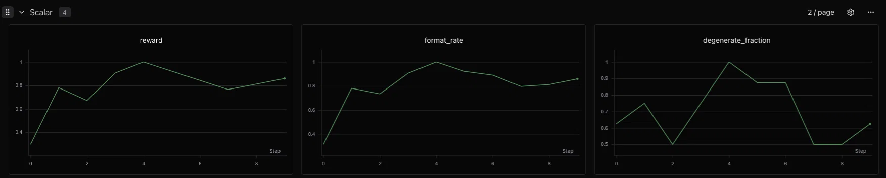

# 03 · Vision GRPO：奖励只认最后一个 boxed

> **Datawhale 组队学习 Task03** · 2026-11-23 ~ 11-25  
> **课程资料**：[Vision GRPO 原文](https://datawhalechina.github.io/agentic-rl-lab/experiments/vision-grpo/) · [快速启动 start.md](https://github.com/datawhalechina/agentic-rl-lab/blob/main/experiments/vision-grpo/start.md)  
> **我的笔记**：[源码](https://github.com/biociao/agentic-rl-lab/blob/study/study/notes/03-vision-grpo.md) · [在线阅读](https://biociao.github.io/agentic-rl-lab/notes/03-vision-grpo) · [博客镜像](https://biochao.cc/agentic-rl/03-vision-grpo/)

## 一、这一章改了什么

这一章没有换算法，还是 02 章的 GRPO（组内减均值 + `importance_sampling`），换的是输入形式：题目里多了一张几何图。新增的工作主要在三处——把图切成 chunk、算准视觉 token 数、把 0 占位对齐到同一根 token 轴上，基本都是工程量。

先看结果。教程报告 100 条固定测试集上准确率从 71.0% 涨到 87.0%，我按「准确率 = 格式率 × 条件准确率」把这 16 个点拆开：

```text
+16.0pp = 格式率提升贡献 +15.2pp  +  条件准确率提升贡献 +0.8pp
```

涨的几乎全是格式：模型终于把答案写成了能解析的形式，几何能力只挪了 0.9 个百分点。教程 §5 也提到这一点，我这里把算术过程补完整（见 §6.4）。自己跑的十步（§7.1）也印证了同一件事：`reward` 与 `format_rate` 两条曲线几乎重合，条件准确率稳定在 98% 上下。

## 二、图文 prompt 的拼装



*图 1 · 数字取自 test 集 id=8121 的真实样本：126 + 70 + 10 = 206。*

纯文本 GRPO 里，prompt 就是一串 token。加上图片以后多了一个问题：图片本身不是 token，本地也没有视觉编码器，编码在服务端完成，本地只负责告诉服务端这张图占多少个位置。两边必须就这个数达成一致，否则后面所有按位置铺开的数组都会错位。

`train.py` 分三步处理：

1. **渲染模板**：`apply_chat_template(..., tokenize=False, enable_thinking=False)`。图片在 messages 里只占一个 `{"type": "image"}`，模板把它渲染成 `<|image_pad|>` 占位符。
2. **按占位符切分**：`prompt.split(IMAGE_PAD_TOKEN)` 得到两段文本，图片字节插在中间，组成 `EncodedTextChunk + ImageChunk + EncodedTextChunk`。这样切的好处是图片位置由模板决定，代码不用自己算偏移。
3. **算视觉 token 数**：`encode_image()` 先用 image processor 算 patch 数，再 `expected_tokens = patches // merge_size ** 2`（16px patch、2×2 合并，所以除以 4）。

两个细节：

- `enable_thinking=False` 并没有把 `</think>` 从模板里删掉，只是留了一个空的 think 块。图 1 里「文本 chunk ②」那 10 个 token 基本都是 `assistant\n<think>\n\n</think>` 这层壳，一样要算进 prompt 长度。
- 采样返回后有一行硬校验：

```python
if response.input_tokens != prompt_length:
    raise ValueError(
        f"图文 prompt 长度不一致：local={prompt_length}, remote={response.input_tokens}"
    )
```

`target_tokens`、old logprobs、advantages 都按同一个 `observation_length` 铺开，所以本地和远端的长度必须一致。这个校验不能省：长度错位不会报错，只会静默地把梯度算错。

## 三、token 账本

GeoQA 的图很小，`test.parquet` 里宽度 71–303px、中位 134.5px，高度中位 109px。我把 100 条测试样本全部过了一遍真实 tokenizer 和 image processor（脚本见 §6.3）：

| 项目 | 最小 | 中位 | 最大 |
| --- | ---: | ---: | ---: |
| 视觉 token（每图） | 64 | 72 | 80 |
| 文本 token | 115 | 137.5 | 209 |
| prompt 总长 | 185 | 209.5 | 281 |

视觉 token 只占 prompt 的 34%，而且在这批图里很稳定（64–80），因为 100 张图尺寸接近。换成高清图，视觉 token 会随 patch 数增长，这份账本要重算。真正拉开 prompt 长度差异的是题干和选项文本。

另外一个数据侧的事实：100 张图的模式是 `RGB` / `P` / `RGBA` 混着的，其中 4 张确实有透明像素（alpha 最低为 0）。所以 `encode_image()` 里先 `convert("RGBA")` 再合成到白底是必要的：直接保存带透明通道的 PNG，透明区域会按黑底渲染，几何图的黑色线条就会和背景糊在一起。

## 四、奖励与组内优势

一个 step 的采样形状是 `batch_size=8` 道题 × `group_size=8` 条回答，题目之间并发，共用同一版 sampler：

```python
rollout_groups = await tqdm_asyncio.gather(
    *(run_rollout_group(...) for row in batch_rows),
)
```

奖励规则只有一句：

```text
r_i = 1    回答里最后一个 \boxed{A-D} 与 label 一致
r_i = 0    其他情况：没有 boxed、boxed 字母不对、输出被截断
```

```python
BOXED_CHOICE_PATTERN = re.compile(
    r"\\boxed\s*\{\s*([A-D])\s*\}", re.IGNORECASE
)
matches = BOXED_CHOICE_PATTERN.findall(text)
return matches[-1].upper() if matches else None
```

三个设计选择：

- **取最后一个**：推理正文里可以先猜一个、算完再改口，只有最终结论算数。这比取第一个宽容，也更符合模型实际的作答方式。
- **只认单个字母**：`\boxed{AB}` 不算。这里要的是「四个选项里选一个」，不是自由作答。
- **没有单独的格式分**：写对但解析不出来，和写错一样得 0。格式是硬门槛，不是加分项。

组内优势还是 02 章那条式子，这里没有除以标准差：

$$
A_i = r_i - \frac{1}{G}\sum_{j=1}^{G} r_j
$$

八条里六对两错时，对的拿 `+0.25`，错的拿 `−0.75`。整组同分（全对或全错）时优势全为零，代码用 `len(set(rewards)) == 1` 识别出来，`continue` 掉，不构造 Datum。这批 rollout 的费用照付，但不产生梯度。

## 五、Datum 的对齐



*图 2 · `observation_length = prompt − 1`，三个数组与 model_input 严格等长。*

| 字段 | prompt / 图片区间 | completion 区间 |
| --- | --- | --- |
| `model_input` | 完整图文 chunks | `completion[:-1]` |
| `target_tokens` | `0` 占位 | 完整 completion tokens |
| `logprobs` | `0.0` 占位 | 采样时返回的 old logprobs |
| `advantages` | `0.0` 占位 | 本条回答的组内优势 |

代码很短，但两个下标容易写错：

```python
observation_length = group.prompt_length - 1
model_input = trio.ModelInput(
    chunks=[
        *group.prompt_chunks,
        trio.types.EncodedTextChunk(tokens=sample.tokens[:-1]),
    ]
)
# target_tokens: [0] * observation_length + sample.tokens
```

为什么 prompt 要减一？因为第 t 个位置的 token 预测的是第 t+1 个 token。把 prompt 长度记作 `P`、completion 长度记作 `L`：`target_tokens` 的 prompt 区间只填 `P−1` 个 0，因为第 `P−1` 格对应 prompt 的最后一个 token，它预测的正是 completion 的第一个 token，从这一格开始就要写 completion 的值；`model_input` 只拼到 `completion[:-1]`，最后一位是 `c[L−2]`，预测 `c[L−1]`。两边都是一个减一、一个不减，长度才都等于 `P + L − 1`。

`logprobs` 存的是采样当时那份权重算出的值，也就是 02 章说的 old logprob，跟着回答一起保存；new logprob 在训练时重算，两者相除得到概率比。多模态没有改变这套机制，只是这根轴从纯文本变成了「文本 + 图 + 文本」。

## 六、本地验证

教程把链路拆成四个脚本，读的时候可以按这个顺序：

| 脚本 | 负责哪一段 | 关键函数 |
| --- | --- | --- |
| `download-dataset.py` | 下载 GeoQA，按 split 拆出 train / 固定 100 条 test | `snapshot_download` + `filter`/`shuffle(seed=42)` |
| `train.py` | 图文拼装、组内采样、规则奖励、Datum、更新 | `encode_image` · `build_prompt_chunks` · `run_rollout_group` · `build_grpo_datum` |
| `eval.py` | 单个 sampler 在固定 100 条上并发评测 | `sample_async` + `extract_choice` |
| `analysis.py` | 用写死的汇总值画对比图 | `BASE_RESULTS` / `GRPO_RESULTS` |

### 6.1 数据体检

```bash
HF_ENDPOINT=https://huggingface.co \
  uv run python experiments/vision-grpo/download-dataset.py
```

（`HF_ENDPOINT` 覆盖官方地址的原因见 02 章：配了镜像后，下载库会认为落地地址和配置不符而失败。）

跑完得到 `train.parquet` 3,503 行、`test.parquet` 100 行，与教程一致。源数据 5,010 条里还有 748 条 dev，这次不用。几个观察：



*图 3 · 几何图基本是黑白线稿，尺寸很小；第三张上还带着做题人手画的箭头标注。*

1. **图片很小**：中位 134×109，视觉 token 中位 72 个，训练成本的大头在 completion 而不是图片。
2. **`answer` 字段里没有 `\boxed`**：100 条里 0 条，数据集自己的写法是「故选:A．」。也就是说 boxed 格式是 prompt 里现编的约定，不是数据里学来的，这一点在拆账时很关键。
3. **标签先验不均衡**：永远选 B 在这 100 条上能拿 35%，随机猜 25%，Base 71%。71% 说明模型确实会做题，不是蒙的；但比较准确率时应该把 35% 这个基线考虑进去。
4. **字段多半没用上**：`formal_point`（知识点）、`comment`（解析点评）都在数据里，训练只看 `image / subject / choices / label`。如果要做过程奖励，这两列是现成的原料。

### 6.2 解析实测

`study/scripts/vision-grpo/01_reward_parsing.py` 直接调用 `train.py` 里真实的正则和解析函数，不联网、不花钱：

```bash
uv run --offline --no-sync python \
  study/scripts/vision-grpo/01_reward_parsing.py
```

```text
情形                        解析结果
标准写法                       C
空格 + 小写                    B
推理中途改口                     D
结尾重复一次                    C
两个字母                      None
没给 boxed（数据集原写法）           None
截断在半截（1024 token 上限）       None
选项正确但写错字母                  B

标准答案为 C 时这一组的得分：[1.0, 0.0, 0.0, 1.0, 0.0, 0.0, 0.0, 0.0]
组内平均分：0.250
逐条优势：[0.75, -0.25, -0.25, 0.75, -0.25, -0.25, -0.25, -0.25]
```

解析规则本身没有问题：空格、小写、中途改口都能正确处理，`\boxed{AB}` 和截断输出都给 0。值得注意的是最后两行：八条里两条对、六条错，优势是 `+0.75` 和 `−0.25`，比 02 章的 `+0.5 / −0.5` 更极端，因为这一组的正确率只有 25%。同样答对一题，组内越难，优势越大。

### 6.3 账本实测

`study/scripts/vision-grpo/02_token_budget.py` 用真实 tokenizer 和 image processor 把 100 条测试样本的长度全算一遍，再核对 `len(ModelInput) == 文本 + 视觉`，最后造一条假 completion 检查四个数组是否等长：

```bash
uv run --offline --no-sync python \
  study/scripts/vision-grpo/02_token_budget.py
```

```text
id     尺寸(w×h)     patch  视觉token   文本token   prompt  视觉占比
8121   163×120     280    70        136       206     34%
1064   113×108     288    72        126       198     36%

100 条测试样本：
  视觉 token    min=64   中位=72.0   max=80
  文本 token    min=115  中位=137.5  max=209
  prompt 总长   min=185  中位=209.5  max=281
  视觉 token 占 prompt 的比例（中位）：34%
  逐条核对 len(ModelInput) == 文本+视觉：全部一致

拼一条 40 token 的假 completion（prompt=206）：
  model_input      = 245  tokens（prompt 206 + completion 去掉末位 39）
  observation_length = 205（prompt - 1，前面全是 0 占位）
  target_tokens  = 245  ✓
  logprobs       = 245  ✓
  advantages     = 245  ✓
```

这一步可以离线跑：`ModelInput`、`ImageChunk`、`Datum` 都是本地对象，拼装和对齐不需要联网，联网的只有采样本身。也就是说最容易出错的长度对齐，可以在不花任何费用的情况下先验证完。

### 6.4 拆账

教程给的四个数是 `71/75` 和 `87/91`（准确率/格式率）。答对必须建立在能解析之上，准确率的分子不会超过格式率的分子，所以这笔账可以精确拆开。`study/scripts/vision-grpo/03_score_decomposition.py`：

```bash
uv run --offline --no-sync python \
  study/scripts/vision-grpo/03_score_decomposition.py
```

```text
二、一致性检查：多出来的 16 条是谁
  新变得可解析的回答：91 − 75 = 16 条
  新增答对的回答：    87 − 71 = 16 条
  ⇒ 这 16 条全都答对了；原先能解析且答对的 71 条一条没丢。

三、拆账（中点分解）
  格式变化贡献：+16.0% 格式率 × 95.1% 平均条件准确率 = +15.22%
  能力变化贡献：+0.94% 条件准确率 × 83% 平均格式率 = +0.78%
  合计：+16.00%（总涨点 +16.00%）
```

（脚本还有两节输出，讲两条硬约束和标签先验，这里不展开。）



*图 4 · 中点分解 `Δ(fc) = Δf·c̄ + Δc·f̄`，两项之和严格等于总涨点。*

我认为最有说服力的是合计那一行：+15.22% 加 +0.78% 正好等于 16.00%，说明这套拆解和教程的数字是自洽的，不是凑出来的。由此可以推出三条：

- **格式率是准确率的上限**。Base 格式率只有 75%，即使能解析的题全部做对，总准确率也到不了 87%。要拿 87%，格式率得先过 87%。
- 如果条件准确率停在 94.7%，格式率需要做到 116% 才能达到 87%，不可能。所以这次涨点必然主要来自格式，算术上是排他的。
- 新变得可解析的 16 条全部答对，原先会做的 71 条一条没丢。训练没有把原本会做的题弄坏，只是把「会做但不会写格式」的那批救了回来。

教程 §5 提到 step 100 还有 9 条解析不出，全部是撑到 1,024 token 被截断的，其余 91 条平均输出 278.8 tokens。模型不是不会做，是还没学会在预算内收尾。

## 七、训练与评测

### 7.1 冒烟与十步实测

先跑 `start.md` 的 1-step 冒烟，确认图文对齐、reward 和账号状态：

```bash
uv run python experiments/vision-grpo/train.py \
  --steps 1 --batch-size 1 --group-size 4 --max-tokens 256 \
  --save-every 0 --no-save-weights --show-samples \
  --swanlab-mode disabled
```

```text
本 batch 平均输出长度：256.0 tokens
Step 1/1 | reward=0.000 | format=0.0% | degenerate=100.0% | datums=0 | loss_mean=n/a
```

单题 4 条全部撑满 256 token、没写出 `\boxed`，整组同分被跳过，`datums=0`。这就是 §四 说的退化：链路是通的，只是这一步不产生梯度。

然后把密度提到正式配置的规模，跑 10 步（其余走默认：lora-rank 32、lr 4e-5、seed 42）：

```bash
uv run python experiments/vision-grpo/train.py \
  --steps 10 --batch-size 8 --group-size 8 --max-tokens 1024 \
  --swanlab-mode online
```



*图 5 · 8 题 × 8 条 × 1,024 token，temperature 1.0。截图右端的横轴刻度被裁掉了，实际是 10 个点（step 0–9）；页签上写着 4 个 scalar，`train_datums` 和 `completion_tokens_mean` 没截进来。*

三条曲线可以互相校对：`degenerate_fraction` 的 10 个点全部落在 `k/8` 上，`reward` 和 `format_rate` 全部落在 `n/64` 上。反推每步是 8 题 × 8 条 = 64 条 completion，和命令参数一致；据此把放大后的像素读数还原成精确分数：

| Step | `reward` | `format_rate` | `degenerate_fraction` | 条件准确率 |
| ---: | ---: | ---: | ---: | ---: |
| 0 | 0.313 | 0.328 | 0.625 | 95.2% |
| 1 | 0.781 | 0.781 | 0.750 | 100% |
| 2 | 0.688 | 0.734 | 0.500 | 93.6% |
| 3 | 0.906 | 0.906 | 0.750 | 100% |
| 4 | 1.000 | 1.000 | 1.000 | 100% |
| 5 | 0.922 | 0.922 | 0.875 | 100% |
| 6 | 0.844 | 0.891 | 0.875 | 94.7% |
| 7 | 0.766 | 0.797 | 0.500 | 96.1% |
| 8 | 0.813 | 0.813 | 0.500 | 100% |
| 9 | 0.859 | 0.859 | 0.625 | 100% |

（条件准确率 = `reward / format_rate`，即「写出了 `\boxed` 的回答里答对的比例」。`reward` 不可能超过 `format_rate`，所以这个比值总不超过 1。）

几点观察：

- **条件准确率几乎贴着 1**：十步合计 98.2%（`Σreward / Σformat_rate`），其中 6 步恰好 100%——凡是写出能解析的 `\boxed`，基本都选对了。这和 §6.4 拆出来的 94.7% 是同一个量级，又一次说明瓶颈在格式而不是几何能力。低于 1 的那 4 步（step 0 / 2 / 6 / 7）才是「格式对了但字母选错」的部分。
- **step 4 最值得看**：`reward`、`format_rate`、`degenerate_fraction` 同时等于 1.0。8 题 64 条全部可解析且全部答对，每个组内部都同分，`len(set(rewards)) == 1` 命中 8 次，`datums=0`——这一步不产生任何梯度，费用照付。退化最纯粹的样子不是题太难，是题太简单。
- **峰值之后回落到 0.86 不必读成「退化」**：step 4 之后每步都会换一版采样权重、也换 8 道题，模型变化和题目难度混在同一个抖动里（02 章也提过这一点）。同理，step 2 的 0.69 也不代表能力掉了一档。
- **噪声量级比看上去大**：`reward` 的最小刻度是 `1/64 ≈ 1.6pp`，`degenerate_fraction` 的刻度是 `1/8 = 12.5pp`。step 7 的 0.50 和 step 1 / 3 的 0.75 之间只差 2 道题。10 步、每步 64 条，单点在一两个刻度内的差异不值得解读，至少要跑满 20 步再谈趋势。
- **别拿 step 0 和教程的 Base 直接比**：step 0 的 0.31 / 0.33 与 §6.4 里 Base 的 71% / 75% 口径不同——一个是 3,503 条训练集上按 temperature 1.0 采 8 条，一个是固定 100 条 test 上按 temperature 0 采 1 条，而且 step 0 的权重还是未更新的 LoRA。要对照必须走 `eval.py`。

十步末点是 `reward` 0.86、`format_rate` 0.86；教程 100 步是格式率 91%、准确率 87%。方向一致，但训练集上的单 seed 曲线不能当 benchmark，真正的对照在 §7.3。

### 7.2 指标与异常排查

训练时默认记录这些指标，我把每个指标异常时该先怀疑什么列了一下：

| 指标 | 含义 | 异常时先怀疑什么 |
| --- | --- | --- |
| `reward` | 本 batch 每题的平均规则奖励 | 题目难度、退化比例 |
| `format_rate` | 能解析出 `\boxed{A-D}` 的比例 | 截断、模板漂移 |
| `degenerate_fraction` | 整组同分、没有相对信号的题目比例 | 题目太简单或太难 |
| `train_datums` | 实际进入 backward 的 completion 数 | 与 `batch×group` 的差值 |
| `rollout/completion_tokens_mean` | 平均生成长度 | 长度爆炸或提前收尾 |
| `trainer/*` | 服务端返回的训练指标 | 学习率、loss 配置 |

### 7.3 评测

评测用 `eval.py` 分别评 Base 和 checkpoint，同一个 `test.parquet`、`temperature=0.0`、`seed=42`、`limit=100`，两次输出写不同文件。教程报告的耗时（48.65s / 49.45s）只对应当时的服务环境，不能当基准。

100 步正式训练我没有跑。`train.py` 和 `eval.py` 每次调用都有实际费用，教程记录 20 步小规模会话消耗 0.62M sample tokens、约 ¥5.06，而且明确说 100 步不能按倍乘估算。§7.1 那十步只够验证一件事：曲线会动，三个指标彼此自洽。能不能把格式率推到 91%、准确率推到 87%，得看 100 步，而且最终结论必须来自固定 100 条上的评测，不是训练集上的曲线。

## 八、一些想法

把格式当硬门槛是一种有意的奖励设计。「写对但解析不出 = 0 分」让 reward 和 accuracy 完全同构，不会出现「格式分很高但答案全错」的假信号；代价是训练早期大量 rollout 被浪费，模型还没学会收尾时，八条回答可能都没有 boxed，整组 degenerate。如果改成「答案对 1 分 + 格式对 0.2 分」，梯度会更密，但马上会面对 reward hacking：模型发现只要输出 `\boxed{A}` 就能拿 0.2，可能直接放弃推理。这两种设计哪种更好，需要跑对照实验，我暂时没有这个数据。

`format_rate` 会被 `max_tokens` 影响，不是纯粹的能力指标。step 100 的 9 条失败全是撞 1,024 token 上限被截断，如果直接把预算提到 2,048，格式率大概率会自己涨一截，准确率也跟着涨，但这不代表模型变强。所以格式率必须和平均输出长度、截断率一起看，否则容易把「预算给够了」误读成「训练有效」。教程特意提到要同时观察这三个量，我觉得这是这一章最实用的一句提醒。

视觉 token 只占 34%，图又这么小，模型是否真的在用图，我没有证据。验证方法比较直接：把测试集的图换成空白图、随机图、其他题的图，各跑一次 100 条，如果准确率几乎不掉，说明这次收益和视觉无关，只是把文本侧的格式学会了。这个消融成本不高，教程没有做，我把它列进待解问题。

`degenerate_fraction` 我原先只当成「浪费」的指标，后来觉得它更像题目难度和模型能力重叠度的读数：太高说明题太简单（全对）或太难（全错），适中说明题目落在最近发展区。教程只记录了数值没有给曲线，§7.1 的十步给了个直观例子：step 4 三条线一起到 1.0，那一步 8 道题全对，`datums=0`，训练等于空转；step 7–8 的 degenerate 掉到 0.50、reward 也回到 0.77–0.81，才是题目和能力错开的样子。

评测口径需要写在结论旁边：100 条子集、单 seed、`temperature=0` 单次采样、同一批题做 Base 与 checkpoint 的配对比较。这些条件决定了 +16pp 只能说明「在这 100 条上更好」，不能直接当成完整 759 条 test 的 benchmark。教程自己把这条边界写在结果旁边，这点做得比较好。

## 九、待解问题

- [ ] 加 0.2 的格式分（正确 1.2 / 仅格式 0.2），收敛会不会更快？会不会出现「只输出 boxed 不推理」的 reward hacking？
- [ ] 图像消融：空白图 / 随机图 / 错题图三组对照，准确率各掉多少？这能直接回答「模型有没有用图」。
- [ ] `degenerate_fraction` 随 step 怎么变？如果一直很高，是不是该像 DAPO 那样做动态采样，把退化组换掉？（十步里它在 0.50–1.00 之间跳、与 reward 同向，十步太短还看不出趋势）
- [ ] 评测用 `temperature=0` 单次采样，是否低估了模型？同一 checkpoint 采 8 次算 pass@8 会是什么样？
- [ ] 用 `formal_point` 做分层评测：涨点集中在哪些知识点？是所有题均匀变好，还是某几类题的格式更容易写对？
- [ ] `analysis.py` 把结果写死在代码里、不读评测 JSON，复现方便但容易和真实结果脱节，这是有意的取舍吗？

## 引用

| 内容 | 链接 |
| --- | --- |
| 教程 | [Agentic RL Lab](https://datawhalechina.github.io/agentic-rl-lab/)（Datawhale，Apache-2.0） |
| 本章原文 | [experiments/vision-grpo](https://datawhalechina.github.io/agentic-rl-lab/experiments/vision-grpo/) · 本地 `experiments/vision-grpo/readme.md` |
| 快速启动 | [start.md](https://github.com/datawhalechina/agentic-rl-lab/blob/main/experiments/vision-grpo/start.md) |
| 数据集 | [hz2475/geoQA](https://huggingface.co/datasets/hz2475/geoQA) |
| 预训练模型 | [Qwen3.5-4B](https://huggingface.co/Qwen/Qwen3.5-4B) |
| 训练服务 | [PyTRIO 文档](https://docs.pytrio.com/docs) · [损失函数](https://docs.pytrio.com/docs/guide/loss_fn) |
| 记录工具 | [SwanLab 文档](https://docs.swanlab.cn/) |
| 论文 | [DeepSeekMath（GRPO 出处）](https://arxiv.org/abs/2402.03300) · [DAPO（动态采样）](https://arxiv.org/abs/2503.14476) |
| 验证脚本 | `study/scripts/vision-grpo/01_reward_parsing.py` · `02_token_budget.py` · `03_score_decomposition.py` |
| 实测记录 | 图 5 · `study/notes/assets/03-vision-grpo/05-swanlab-10steps.png`（8 题 × 8 条 × 1,024 token，10 步，SwanLab） |

本笔记与示意图采用 [CC BY-NC-SA 4.0](https://creativecommons.org/licenses/by-nc-sa/4.0/deed.zh-hans)。
